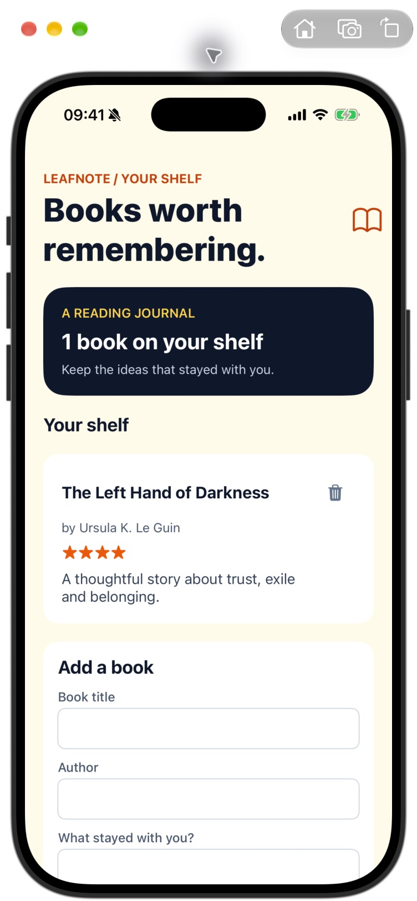

# Leafnote

A reading journal built with Laravel 13 and SuperNative in NativePHP Mobile 4. Record a title, author, short review and one to five stars. Entries live in the device's SQLite database.



## Run it

Requirements: PHP 8.3+, Composer, Xcode and an iOS simulator. Clone the repository, then run:

```bash
composer install
cp .env.example .env
php artisan key:generate
php artisan native:install ios
php artisan native:run ios
```

Set `NATIVEPHP_APP_ID` in `.env` to a bundle identifier you own before distributing the app. NativePHP prepares and migrates the app's SQLite database on the simulator or device.

## Where the app lives

- `routes/web.php` registers the native root route.
- `app/NativeComponents/Library.php` holds typed form state, rating and save actions.
- `resources/views/native/library.blade.php` renders the native UI.
- `app/Models/Book.php` and the book migration persist the shelf locally.
- `tests/Feature/LibraryScreenTest.php` checks saving and validation.

The app uses the official `nativephp/mobile-ui` package for native text, input and icon rendering. It has no additional device feature plugins. Run `php artisan test` for the PHP interaction tests. The screenshot was captured after an iOS simulator build and manual title, author, review, rating and save checks.
